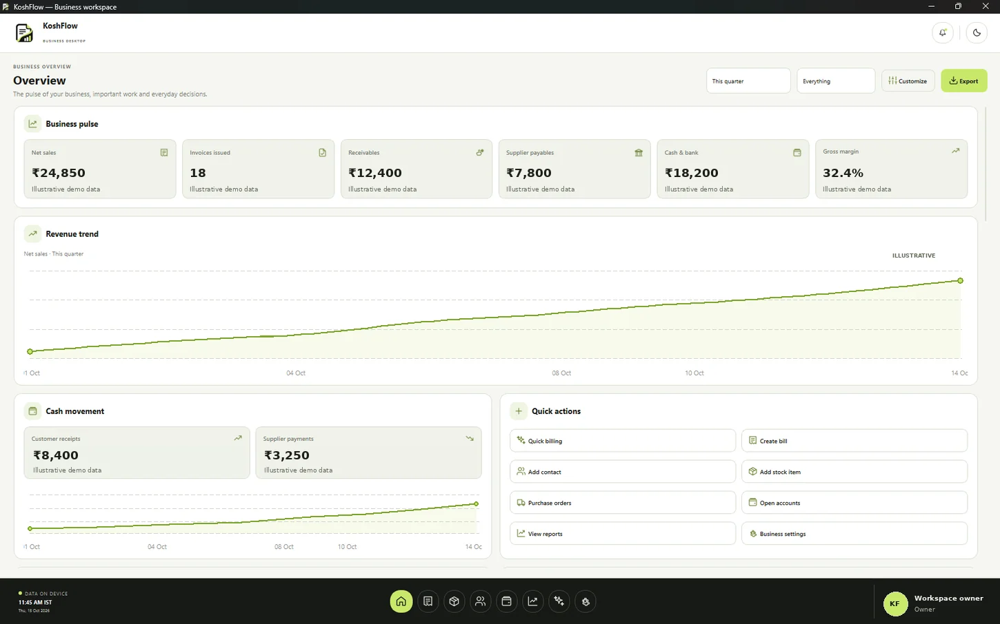
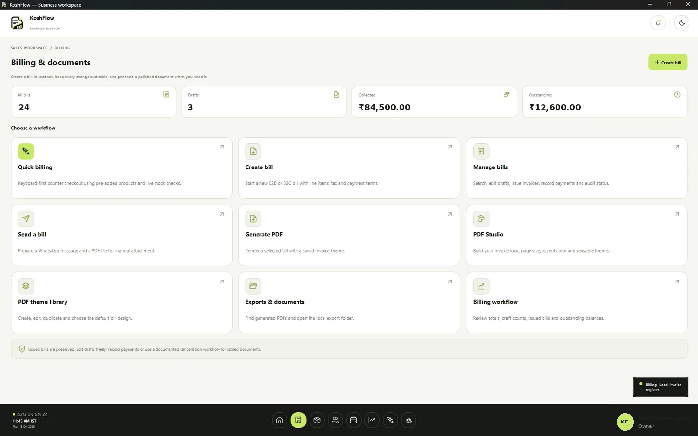
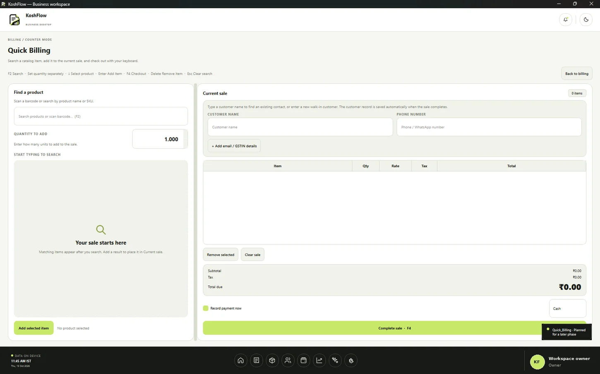
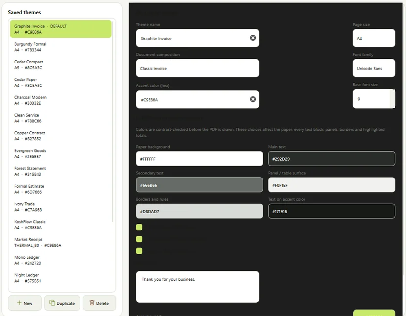
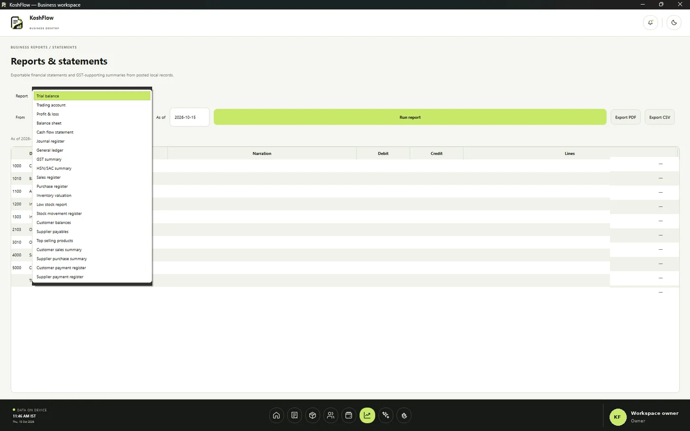
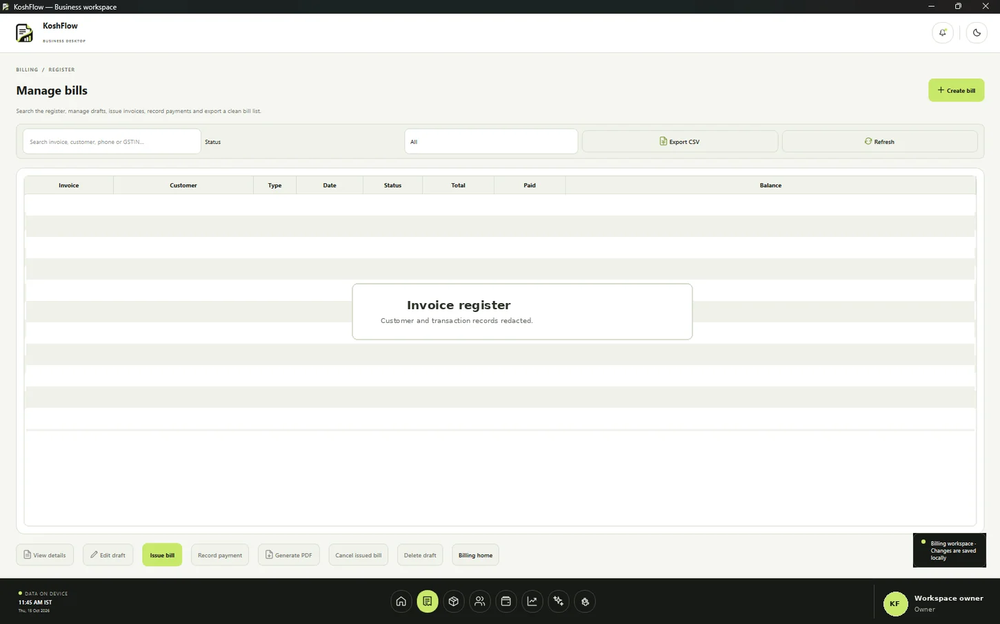

# KoshFlow

**KoshFlow is a Windows-first desktop workspace for billing, inventory, purchasing, customer and supplier records, accounting reports, and branded business documents.** It is designed around local data storage, a keyboard-friendly workflow, and a consistent light/dark interface.

- **Source version:** `0.6.3`
- **Database schema:** `7`
- **Primary platform:** Windows 10/11 (x64)
- **Runtime:** Python 3.11 or newer
- **Desktop UI:** PySide6 / Qt
- **Storage:** SQLite in the current user's local application-data directory
- **Document engine:** ReportLab and Pillow
- **Maintainer:** Mayank Chawdhari (BOSS294)

> **Project status:** KoshFlow is an actively developed desktop application. The current source contains substantial billing, inventory, purchasing and accounting workflows, but it has not yet completed an independent production-security review, code signing, or a formal statutory-tax-compliance certification. Test with a copy of your data before using a new build for live transactions.

## Contents

- [Product overview](#product-overview)
- [Screenshots](#screenshots)
- [Features](#features)
- [Download the Windows executable](#download-the-windows-executable)
- [Install and run from source](#install-and-run-from-source)
- [First-run setup](#first-run-setup)
- [User guides](#user-guides)
- [Keyboard workflow](#keyboard-workflow)
- [Data, backups and privacy](#data-backups-and-privacy)
- [Architecture for developers](#architecture-for-developers)
- [Run tests](#run-tests)
- [Build a Windows executable](#build-a-windows-executable)
- [Publish the website with GitHub Pages](#publish-the-website-with-github-pages)
- [Release history](#release-history)
- [Known boundaries](#known-boundaries)
- [Contributing](#contributing)
- [License](#license)

## Product overview

KoshFlow brings daily business operations into one desktop workspace. The goal is to reduce the need to move between disconnected billing, stock, customer, supplier and reporting tools, while retaining control over local business data.

The application uses a 60/30/10 visual system: white or neutral surfaces, charcoal structure, and citron-lime (`#C9E86A`) for meaningful emphasis. Light and dark themes, typography preferences, UI scaling and control-density options are part of the desktop settings.

### Screenshots

Screenshots in `assets/site/` are sanitized for public documentation. Identifying profile details and actual transaction values have been replaced or cropped out.

| Workspace | Screenshot |
|---|---|
| Overview dashboard |  |
| Billing workspace |  |
| Quick Billing |  |
| Invoice theme designer |  |
| Reports |  |
| Bill register |  |

## Features

### Billing and documents

- Create, review, issue, search, filter and manage invoices.
- Draft lifecycle and controls for issued-document correction/cancellation.
- B2B/B2C document classification and line-level quantities, discounts and configurable tax rates.
- Partial or full customer-payment recording and balance tracking.
- Quick Billing for counter sales, with catalog search, customer lookup, quantity entry and stock validation.
- PDF generation from saved bills and an export/document area.

### PDF Studio and invoice branding

- Starter themes and custom reusable invoice templates.
- Whole-document design controls: page size, composition, typography, background/surface/text colors, rules and highlighted totals.
- Live invoice preview and saved theme selection.
- Optional business logo, business name, address, contact information and website.
- Optional bank details, UPI ID and QR image on invoices.
- Invoice footer attribution: “Generated by KoshFlow”.
- PDF layouts designed for multi-page documents and supported paper sizes.

### Inventory and purchasing

- Product catalog with SKU generation, categories, units, HSN/SAC fields and pricing.
- Stock adjustments and a traceable stock-movement register.
- Suppliers, purchase orders, partial receipt workflows and purchase bills.
- Supplier payments, supplier returns and credit tracking.
- Reorder/low-stock reporting and inventory valuation using recorded moving-average cost.
- Stock changes are linked to source transactions where the workflow supports it; stock should not be adjusted outside the application's transaction controls.

### Customers and suppliers

- Local customer and supplier records, contact information and business identifiers.
- Customer autocomplete in Quick Billing and walk-in customer persistence after a completed sale.
- Customer balances, supplier payables, transaction histories and searchable directories.
- CSV exports in supported registers and reports.

### Accounting and reports

- Chart of accounts, double-entry journals and manual journal vouchers.
- Trial Balance, Trading Account, Profit & Loss, Balance Sheet, Cash Flow Statement and General Ledger.
- Journal register, individual voucher export, accounting-period history and supporting sales/purchase registers.
- Operational reports including inventory valuation, stock movements, customer balances, supplier payables, payment registers, top-selling products and GST/HSN-SAC summaries.
- PDF and CSV export for supported reports.
- Accounting-period locking controls.

These reports are generated from local records and accounting entries. Review them against source documents before relying on them for statutory or financial decisions.

### Dashboard and notifications

- Dashboard metrics and charts sourced from available local business records.
- Quick actions for common workflows.
- Persistent in-app notification inbox and desktop-notification integration where the operating system supports it.
- Notification preferences and test action in Settings.
- Notification delivery depends on Windows notification permissions and system-tray availability; an in-app fallback is used where available.

### Security and personalization

- Local user setup and login, with Argon2 password hashing.
- Role-aware navigation and service-level permission checks in supported workflows.
- Locally stored user preferences, profile image, light/dark themes, font selection, UI scale and control sizing.
- Local database, logs, exports and backup directories.

## Download the Windows executable

The public website is configured to find `KoshFlow.exe` attached to the latest GitHub Release. The repository also includes a GitHub Actions workflow that builds the Windows executable when a version tag such as `v0.6.4` is pushed.

1. Open the [KoshFlow Releases page](https://github.com/BOSS294/KoshFlow/releases).
2. Open the latest stable release.
3. Download `KoshFlow.exe` from its assets.
4. Save it to a folder you control and run it. Your local application data is stored separately in your user profile.

The packaged file is a **portable executable**, not a traditional setup wizard. Code signing is not configured in this repository snapshot, so Windows may display publisher or reputation warnings. Download only from the official project repository and do not bypass security warnings unless you have independently verified the source and release artifact.

If the Releases page has no executable asset yet, use [Install and run from source](#install-and-run-from-source) or build the executable as described below. The repository slug is configured as `BOSS294/KoshFlow`; update the website configuration and links if the final GitHub repository uses a different owner or name.

## Install and run from source

### Requirements

- Windows 10/11 x64 is the intended desktop target.
- Python 3.11 or newer.
- Internet access for the initial dependency installation only.
- A writable user-data directory for the SQLite database, logs, exports and backups.

### Setup

Clone or download the source repository, then run these commands from the project root in PowerShell:

```powershell
git clone https://github.com/BOSS294/KoshFlow.git
cd KoshFlow

python -m venv .venv
.\.venv\Scripts\Activate.ps1
python -m pip install --upgrade pip
python -m pip install -r requirements.txt
python main.py
```

If PowerShell blocks virtual-environment activation, use the Python executable directly instead:

```powershell
.\.venv\Scripts\python.exe -m pip install -r requirements.txt
.\.venv\Scripts\python.exe main.py
```

The application opens first-run setup if the database has no local user; otherwise it opens the login screen.

## First-run setup

1. Launch KoshFlow and create the local owner account.
2. Enter the business's registered/legal name and any applicable business details.
3. Configure state/UT, contact information, and GST/PAN details only where applicable.
4. Open Settings to set invoice branding, payment details, appearance preferences and notification preferences.
5. Create a backup before importing or entering substantial live data.
6. Create catalog products and suppliers before using inventory-linked purchasing or Quick Billing.

Use real legal names, tax registrations and banking details only in your private local workspace. Public screenshots and issue attachments should use sanitized sample records.

## User guides

### Create and issue a bill

1. Open **Billing** and choose **Create bill**.
2. Select or enter the customer, add items or services, verify quantities, rates, discount and applicable tax.
3. Review totals and payment terms.
4. Save as a draft while it is still being prepared. Issue only after reviewing the document.
5. Generate the PDF from the saved bill and verify the business identity, customer details, line items, totals and payment instructions before sending it.

Issued financial documents should not be silently overwritten. Use the available payment, cancellation or correction workflow appropriate to the document's state.

### Use Quick Billing

1. Open Billing and select **Quick Billing**.
2. Search a pre-added product by name, SKU or barcode.
3. Set the quantity separately and add the selected product.
4. Enter the customer name and phone number where available. Select a matching customer suggestion when shown; otherwise the counter-sale flow can save a new customer record.
5. Verify the current sale, payment method and total.
6. Complete the sale only when the items and stock are correct.

### Manage inventory and purchases

1. Create categories and catalog products with the appropriate unit and product details.
2. Add supplier profiles before recording purchases.
3. Create a purchase order and receive only quantities actually delivered.
4. Match the supplier's invoice/reference to the receipt-generated purchase-bill draft before posting it.
5. Record supplier payments and returns through their dedicated workflows.
6. Use Stock Movements to trace the source, reason and quantity change.

HSN/SAC suggestions are assistance, not authoritative tax classification. Confirm the correct classification and applicable rate before issuing statutory invoices.

### Generate and send PDFs

1. Set the business identity and payment details in Settings.
2. Open PDF Studio to choose or customize a document theme.
3. Review the live preview with the intended composition, page size, logo, contacts and payment section.
4. Generate the PDF from the saved bill.
5. WhatsApp sharing prepares the message/workflow; where the app opens WhatsApp for manual sharing, attach the generated PDF yourself and confirm the correct recipient.

### Export accounting reports

1. Open **Reports**.
2. Choose the report and applicable date range or as-of date.
3. Run the report and inspect the displayed source period.
4. Export PDF for a formatted report or CSV for further analysis.
5. Reconcile reports with invoice, purchase, payment and journal source records before making accounting or compliance decisions.

### Configure desktop notifications

1. Open Settings and choose **Notifications**.
2. Enable the notification channels and event categories you want.
3. Use the test action to check whether the native desktop request is submitted or the app uses its in-app fallback.
4. If Windows doesn't show a native alert, check Windows notification permissions and Focus/Do Not Disturb settings.

### Back up and restore

1. Open Settings and select **Data & Backups**.
2. Create a backup and wait for verification to finish.
3. Keep a second copy outside the computer that contains the working database.
4. Test restore with a copy before replacing the primary database.

Backups in this source version are standard SQLite backup files and are not encrypted by the application. Store them somewhere protected by your operating-system account and appropriate disk encryption.

## Keyboard workflow

Shortcuts can be context-specific; the Quick Billing controls are the primary keyboard-first workflow in this release.

| Shortcut | Action |
|---|---|
| `F2` | Focus product search in Quick Billing |
| `Down` | Move from product search into matching results |
| `Enter` | Add the selected matching product, where a result is selected |
| `F4` | Begin/confirm Quick Billing checkout flow |
| `Delete` | Remove the selected sale item when the cart is focused |
| `Esc` | Clear the product search |
| `Ctrl+K` | Open the command palette where available |
| `Ctrl+N` | Start a new bill where the current page supports the shortcut |

Shortcuts never replace stock validation or required checkout confirmation. When a shortcut appears not to work, first focus the relevant input/table and verify that the current page supports it.

## Data, backups and privacy

- **Default data directory on Windows:** `%LOCALAPPDATA%\KoshFlow\`
- Database: `koshflow.sqlite3`
- Supporting directories: `backups/`, `logs/`, and `exports/`
- `KOSHFLOW_HOME` can override the data directory for portable/test runs.
- The app is local-first; it does not require a KoshFlow-hosted account or cloud database to open the local workspace.
- Windows desktop notifications depend on operating-system support and permissions.
- Opening WhatsApp is an external action. The user remains responsible for confirming recipient and attachment.
- AI Business Insights is currently a coming-soon area; do not assume a live AI analysis provider is connected.
- Backup files are not encrypted at rest by the app in this release.

Do not attach a real business database, unredacted invoice, customer list, phone number, bank details, or backup file to a public GitHub issue.

## Architecture for developers

KoshFlow separates its Qt UI from business services and database operations. The intended rule is that financial calculations and transaction rules live in services, not in presentation widgets.

### Technology

| Area | Implementation |
|---|---|
| Desktop UI | PySide6 / Qt Widgets |
| Language | Python 3.11+ |
| Database | SQLite using the standard library and application schema migrations |
| Authentication | `argon2-cffi` password hashing |
| Invoice and accounting PDFs | ReportLab |
| Logo/image processing | Pillow |
| Testing | pytest |
| Windows executable | PyInstaller spec and GitHub Actions release workflow |

### High-level project layout

```text
KoshFlow/
├── assets/                   # App icon, brand mark, public-site screenshots
├── .github/workflows/        # Tests and tagged Windows executable release
├── koshflow/
│   ├── core/                 # Database, schema migrations, permissions, backups, session
│   ├── services/             # Auth, billing, inventory, customers, accounting, reports,
│   │                         # PDF generation, dashboard, notifications and setup
│   ├── ui/
│   │   ├── pages/             # Dashboard, billing, inventory, settings and report screens
│   │   ├── components.py      # Reusable Qt controls
│   │   ├── icons.py           # SVG icon helpers
│   │   ├── styles.py          # Light/dark design tokens and global widget styles
│   │   └── main_window.py     # Workspace shell, navigation and global actions
│   ├── app.py                 # Qt startup, logging, data setup and login gateway
│   └── config.py              # Version, paths and application identifiers
├── tests/                     # Service, accounting, workflow, reporting and UI contract tests
├── KoshFlow.spec              # PyInstaller one-file build configuration
├── index.html                 # Static GitHub Pages site
├── main.py                    # Source launcher
├── pyproject.toml
└── requirements.txt
```

### Design and service boundaries

- UI pages gather input and render service results.
- Services validate workflow rules, enforce transaction boundaries and return structured records.
- The database layer initializes the schema and applies additive migrations.
- Decimal arithmetic is used for monetary calculations; avoid binary floating-point for accounting totals.
- Posted documents need auditable correction/reversal behavior rather than silent mutation.
- Reports should state their reporting period and use journal/source records as their authority.
- Store user preferences locally and keep customer/business data out of logs and public test fixtures.

### Run developer checks

```powershell
python -m pip install -r requirements.txt
python -m pip install pytest
python -m compileall -q koshflow main.py
python -m pytest -q
```

The v0.6.3 validation run recorded **101 tests passing**. Run the test suite again for every code change and report the result from the branch being submitted rather than copying a historical count.

## Build a Windows executable

The repository includes `KoshFlow.spec` and `.github/workflows/windows-release.yml`.

### Local build

```powershell
python -m pip install -r requirements.txt
python -m pip install pyinstaller
python -m PyInstaller --noconfirm --clean KoshFlow.spec
```

The expected output is `dist\KoshFlow.exe`. This is a portable single-file executable, not an installer wizard. PyInstaller bundles the Python runtime and application dependencies; the user's database stays in the per-user data directory.

### Publish a release asset

1. Update version constants and release notes for the new version.
2. Run the full tests on the intended commit.
3. Commit and push the branch.
4. Create and push a version tag, for example `v0.6.4`.
5. The Windows release workflow runs the test suite, builds `KoshFlow.exe` and attaches it to a GitHub Release.
6. Check the release page and download/run the artifact on a clean Windows account before announcing the release.

The executable is unsigned in the current configuration. Add Windows code-signing and verify release hashes before distributing a production release broadly.

## Publish the website with GitHub Pages

`index.html` is a static page at the repository root. It uses local CSS and JavaScript and the sanitized images under `assets/site/`.

1. Push this repository to GitHub.
2. In **Settings → Pages**, select deployment from the `main` branch and `/ (root)`.
3. Wait for the Pages deployment to complete.
4. The page's release widget reads the repository's GitHub Releases API and looks for `KoshFlow.exe`. If the API is unavailable or no release exists, it falls back to the releases page.
5. Confirm that the repository setting in `index.html` matches the real owner/repository slug. The default is `BOSS294/KoshFlow`.

The release workflow creates the executable link target; until a tagged release has published that asset, the site cannot provide a downloadable binary. Update the version highlights and release notes when a new version is published.

## Release history

### v0.6.3

- Refined the Overview dashboard and business identity panel.
- Added the animated AI Business Insights coming-soon experience.
- Added notification preferences and a notification test action.
- Refined profile popover behavior and light/dark theme surfaces.

### v0.6.2

- Connected operational dashboard metrics and added operational report queries.
- Expanded the Reports workspace and added local notification persistence.
- Removed the Services navigation module.

### v0.6.1

- Added Trading Account and journal-register PDF exports.
- Improved branded, multi-page accounting report output.

### v0.6.0

- Added the double-entry accounting foundation and core financial statements.
- Improved PDF business branding and accounting exports.

Earlier release history is available through the Git commit/tag history once published.

## Known boundaries

- AI Business Insights is a coming-soon area; a live AI provider is not represented as active.
- Reports can prepare GST-supporting summaries, but statutory return filing and official GST portal submissions are not implemented by the report export itself.
- E-invoice, e-way bill, bank-feed and automated WhatsApp document delivery integrations require separate implementation and verification.
- Cloud synchronization and multi-device collaboration are not part of the local-first data model in this release.
- Backup encryption at rest and a formal security audit remain outstanding.
- This source snapshot does not include a signed Windows executable; the tagged release workflow must be run to publish one.

## Contributing

1. Open an issue describing the defect or enhancement and the affected workflow.
2. Do not attach production databases, invoices or personal/customer data.
3. Create a focused branch and keep changes within the requested scope.
4. Add or update tests for service logic, migrations and financial/reporting behavior.
5. Run `python -m compileall -q koshflow main.py` and `python -m pytest -q`.
6. Include clear reproduction steps and screenshots with sanitized data for UI changes.

Accounting changes should include examples that prove debit/credit balance, source-document idempotency, and the impact on linked balances or stock quantities.

## License

The current source snapshot does not include a `LICENSE` file. Public visibility on GitHub does not by itself grant permission to reuse, modify or redistribute the project. The repository owner should add a clear license before accepting external code contributions or announcing the project as open source.
